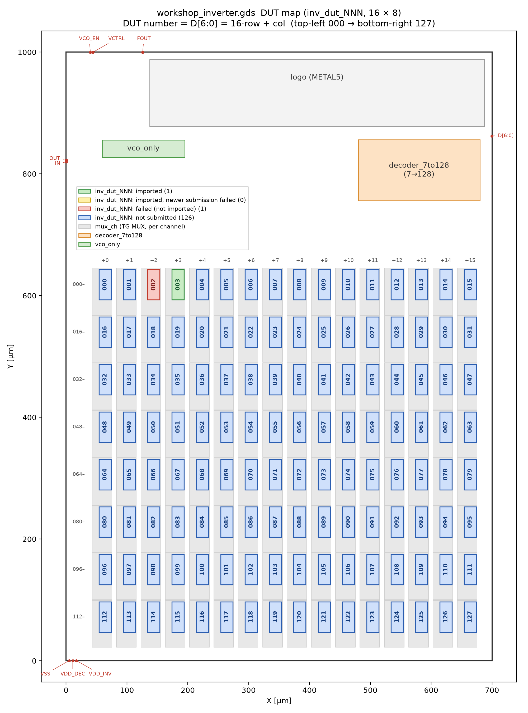
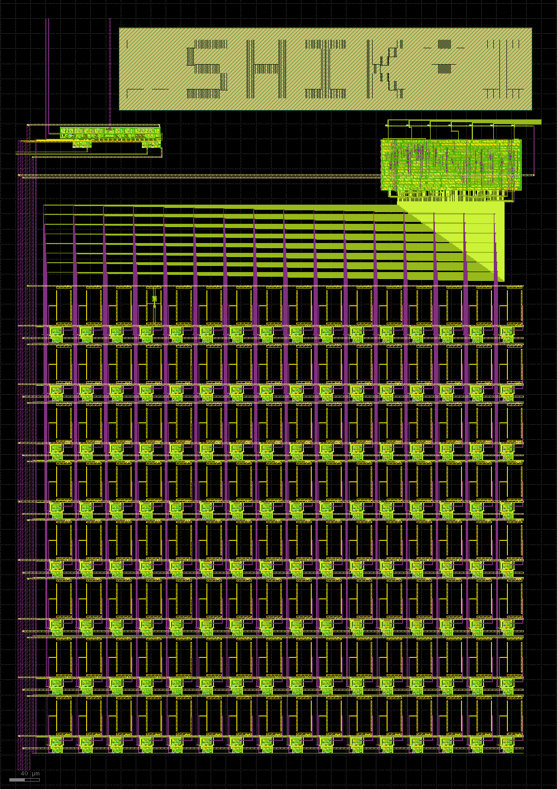
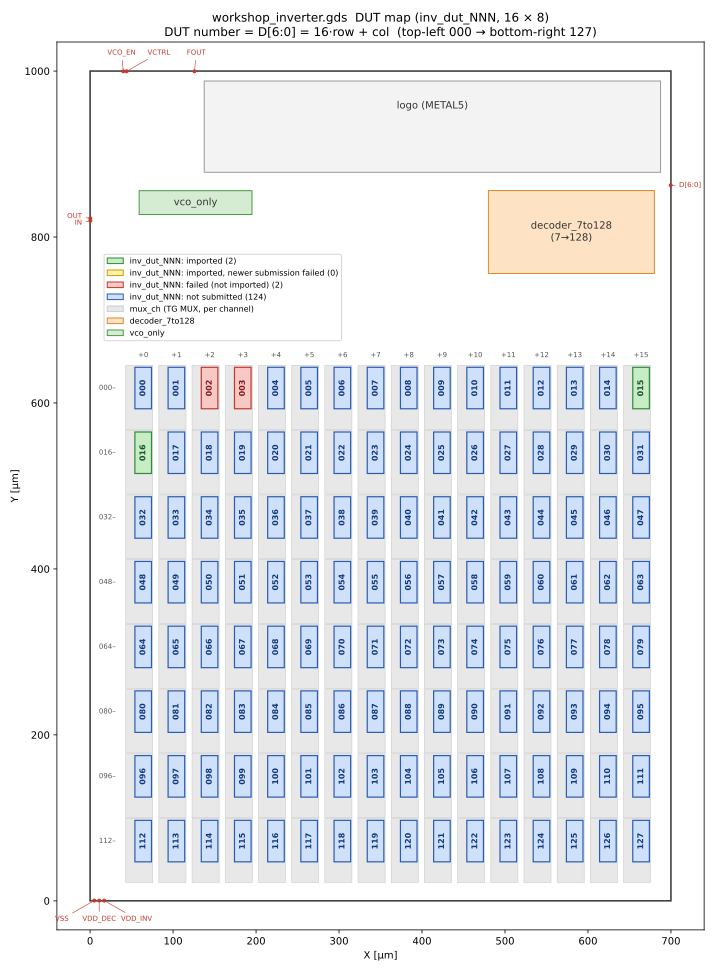

# [RISC-V Day Tokyo 2026 Autumn](https://riscv.or.jp/risc-v-day-tokyo-2026-autumn/) の [CMOSインバータ設計と半導体チップ製作](https://riscv.or.jp/risc-v-day-tokyo-2026-autumn-tutorials-2/)ワークショップ用のMPWシステム
[RISC-V Day Tokyo 2026 Autumn](https://riscv.or.jp/risc-v-day-tokyo-2026-autumn/) で実施予定の [CMOSインバータ設計と半導体チップ製作](https://riscv.or.jp/risc-v-day-tokyo-2026-autumn-tutorials-2/)ワークショップで作成される参加者のインバータ回路をまとめて、1つのチップ上に配置するMPW用のシステムです。  

各インバータ回路を「DUT」と呼称し、[DUTのテンプレート](https://github.com/ishi-kai/RISC-V-Day_MPW_template.git)を投稿してもらうことで自動で所定の場所にマージするシステムとなっています。  

- [DUTのテンプレート](https://github.com/ishi-kai/RISC-V-Day_MPW_template.git)
- 
    - 各 DUT の色は投稿の処理状況（自動で更新。詳細は [report](report/) の `NNN_<日時>.md`）:
      **緑** ＝ 取り込み済み、**黄** ＝ 取り込み済みだがその後の再投稿がエラー（取り込み済みのものを使用）、
      **赤** ＝ 投稿があったがエラーのため取り込めていない、**薄青** ＝ 未投稿
- 


## ワークショップ内容
ワークショップの詳細は、[RISC-V Day Tokyo 2026 Autumn のCMOSインバータ設計と半導体チップ製作](https://riscv.or.jp/risc-v-day-tokyo-2026-autumn-tutorials-2/)をご覧ください。  
当日、利用するテキストは下記になります。開発環境は事前にセットアップ済みであることが前提となっています  

- [テキスト：PDF版](docs/inverter_RISC-V-Day.pdf)
- [テキスト：PPTX版](docs/inverter_RISC-V-Day.pptx)


### 開発環境構築について
開発環境構築は、セットアップ済みのWSLイメージで用意しています。ダウンロードして、事前にセットアップしてください。  
事前に開発環境の構築が終わっていない場合は「**会場の回線が貧弱なため、WSLイメージのダウンロードだけで時間が終わる**」可能性が高いため、参加を見送られることをお勧めします。  


#### WSLイメージのダウンロード
下記からダウンロードしてください。ダウンロード後、適当なディレクトリに解凍してください。  

- [WSLイメージのダウンロード]()


#### WSLイメージのセットアップ
Windows PowerShellを起動して、WSLイメージを解凍したディレクトリに移動し、下記のコマンドを実行してください。  

- wsl --import-in-place ubuntu2404_ishi-kai_EDA .\ubuntu2404_ishi-kai_EDA\ext4.vhdx


#### WSLイメージの起動方法
ショットカット（ubuntu2404_ishi-kai_EDA.lnk）を利用して起動してください。  
ショートカットを使わない場合は、rootユーザとして起動します。その場合は「su ishi-kai」でユーザを切り替えてください。  

- ID: ishi-kai
- Pass: ishi-kai


## DUTについて
各インバータ回路を「DUT」と呼称しています。各DUTには最初からパラメータを設定していますので、各自割り当てられたDUTのパラメータに合わせて、インバータ回路を設計・レイアウトしてください。  


### DUT のパラメータ
各DUTのパラメータはcsvファイルにまとめてあります。  

- [DUT params](docs/dut_params.csv)


### DUT のテンプレート
MPWとして複数人で枠をシェアするため、DUTとして利用できるエリアを設定したレイアウト用のテンプレートを用意しています。これをベースにレイアウトしてください。  

- [GDSファイルのテンプレート](GDS/inv_dut_NNN.gds)


### DUT の配置
数字は DUT 番号 ＝ D[6:0]。左上 000 → 右下 127、番号 ＝ 16 × 行 ＋ 列。各 DUT の上がその ch の `mux_ch`で並んでいます。  

各 DUT の色は投稿の処理状況を表しています（投稿を処理するたびに自動で更新されます）。結果の詳細は [report](report/) ディレクトリの `NNN_<日時>.md` を見てください。  

| 色 | 状態 |
|---|---|
| 緑 | 取り込み済み |
| 黄 | 取り込み済みだが、その後の再投稿がエラー（取り込み済みのものがそのまま使われます） |
| 赤 | 投稿があったがエラーのため取り込めていない（修正して再投稿してください） |
| 薄青 | 未投稿 |

- 
- 


# 詳細解説
GF180MCU (gf180mcuD) で作る、インバータ特性評価用のテストチップ。
128 個の DUT インバータを 7bit のデコーダで 1 つずつ選んで IN / OUT パッドから測る **インバータマトリクス** と、
選んだ DUT をリングに入れて遅延を周波数で測る **VCO** からなる。

元の作業指示は `prompt.md`。

## 全体構成

| ディレクトリ | 内容 |
|---|---|
| `inverter_matrix/` | 128ch DUT インバータ、7→128 デコーダ、TG MUX の回路図・DUT レイアウト・テストベンチ（インバータマトリクスの章） |
| `inverter_matrix/sim_layout/` | レイアウト抽出ネットリストでの全 128ch インバータ動作確認 |
| `vco/sim_layout/` | レイアウト抽出ネットリストでの全 128ch VCO 周波数 |
| `vco/` | 電流制限型リング VCO と切替 TG の回路図・レイアウト・テストベンチ（VCO の章） |
| `layout/` | トップレイアウト `workshop_inverter.gds`（700 × 1000µm）と DRC / LVS（トップレイアウトの章） |
| `librelane-tg-logic/` | デコーダ `decoder_7to128` を作った LibreLane 環境（元のリポジトリの README を参照） |
| `inverter_base.gds` | DUT セルの枠（20 × 50µm）。`inv_dut_NNN` はこれをベースにする |
| `workshop_inverter.sch` | トップの回路図 |

### 電源とピン

| ピン | 内容 |
|---|---|
| D[6:0] | DUT 選択（デコーダ入力、0 / VDD_DEC）。レイアウトでは右側 |
| IN / OUT | 選択 DUT の入力 / 出力（インバータモード）。レイアウトでは左側 |
| VCO_EN, VCTRL, FOUT | VCO の有効化 / 周波数制御 / 発振出力。レイアウトでは上側 |
| VDD_DEC | 5V。デコーダ、TG のゲートと N-well、VCO_EN 論理 |
| VDD_INV | DUT 128 個と VCO の CS 段・バイアス・バッファ（共通）。VDD_INV ≦ VDD_DEC |
| VSS | 共通 |

**注意**: VDD_INV は 128 個の DUT で共通。3.3V 品の DUT（64 個）があるので、5V 品を 5V で測ると
3.3V 品にも 5V がかかる（インバータマトリクスの章の「レイアウト抽出ネットリストでの全 128ch 確認」を参照）。

## トップレイアウト（`layout/`）

| ファイル | 内容 |
|---|---|
| `workshop_inverter.gds` | トップレイアウト。DUT は `inv_dut_000`〜`127`（16 × 8 のグリッド）のセルで、後から差し替えられる |
| `workshop_inverter.cdl` | LVS 用リファレンスネットリスト（`gen_lvs_netlist.py` が `inverter_matrix/dut_params.csv` から作る） |
| `workshop_inverter_extracted.cir`, `workshop_inverter.lvsdb` | KLayout LVS の抽出ネットリスト（シミュレーション用、`--top_lvl_pins --spice_comments`） |
| `gen_top_layout.py` | トップレイアウト生成 |
| `replace_dut.py` | `inv_dut_NNN` セルを別の GDS（`inverter_matrix/layout/inv_dut_NNN.gds` など）で差し替え、CDL も更新 |
| `check_top.py` | DRC と LVS（デコーダ、スタンダードセル、`inv_dut_NNN` 以外のセルは平坦化して比較） |

DUT の配置（数字は DUT 番号 ＝ D[6:0]。左上 000 → 右下 127、番号 ＝ 16 × 行 ＋ 列。各 DUT の上がその ch の `mux_ch`）:


各 DUT の色は投稿の処理状況（投稿を処理するたびに自動で更新。詳細は [report](report/) の `NNN_<日時>.md`）:
**緑** ＝ 取り込み済み、**黄** ＝ 取り込み済みだがその後の再投稿がエラー（取り込み済みのものを使用）、
**赤** ＝ 投稿があったがエラーのため取り込めていない、**薄青** ＝ 未投稿。

PCell（via_dev など）は `~/src/gf180mcuD` のもの、DRC / LVS のデッキは `~/pdk/gf180mcuD` のものを使う。

```bash
cd layout
python3 replace_dut.py ../inverter_matrix/layout/inv_dut_021.gds [...]   # DUT セルの差し替え
python3 check_top.py [--threads N]                                      # DRC / LVS
python3 ~/pdk/gf180mcuD/libs.tech/klayout/tech/lvs/run_lvs.py --layout=$PWD/workshop_inverter.gds \
    --netlist=$PWD/workshop_inverter.cdl --variant=D --topcell=workshop_inverter --run_dir=<dir> \
    --combine --top_lvl_pins --spice_comments                          # シミュレーション用の抽出
#   → <dir>/workshop_inverter.cir を workshop_inverter_extracted.cir に、.lvsdb も置き換える
```

状態: DRC クリーン / LVS 一致（DUT 021 / 053 / 085 / 117 の N_W を 2.70u に修正した後）。

## インバータマトリクス（128ch DUT インバータ ＋ 7→128 デコーダ ＋ TG MUX）

ディレクトリ: `inverter_matrix/`（この章のファイル名・コマンドは `inverter_matrix/` から見たパス）

128 個の DUT インバータを 1 組の IN / OUT パッドで切り替えて測定する回路。
D[6:0] をデコーダ（LibreLane で作成した 7→128 one-hot デコーダ）で SEL[127:0] に変換し、
各チャネルの TG（トランスミッションゲート）MUX で 1 つの DUT だけを IN / OUT につなぐ。
PDK: GF180MCU (gf180mcuD)。MUX・デコーダは 5V 品（`nfet_05v0` / `pfet_05v0`）、DUT は 3.3V 品 / 5V 品の混在が可能。

`vco/` の VCO はこの `inv_matrix_top` の選択 DUT をリングの 7 段目として使う。

### ブロック図

```
              D[6:0]
                │
        ┌───────▼────────┐  SEL[127:0] (one-hot, 0 / VDD_DEC)
        │ decoder_7to128 ├──────────────┬──────────────┬─── ...
        └────────────────┘              │              │
                                  ┌─────▼─────┐  ┌─────▼─────┐
  IN ──────────────┬──────────────┤ mux_ch #0 ├──┤ mux_ch #1 ├── ... (128ch)
                   │              │ TG_in     │  │           │
                   │              │   │       │  │           │
                   │              │ DUT_IN ─► inv_dut_000 ─► DUT_OUT
                   │              │ TG_out    │  │           │
  OUT ─────────────┴──────────────┤           ├──┤           ├── ...
                                  └───────────┘  └───────────┘
```

mux_ch_5v0（1 チャネル分）:

| SEL | TG_in / TG_out | DUT_IN | 動作 |
|---|---|---|---|
| 1 | ON | IN | 選択チャネル: IN → DUT → OUT |
| 0 | OFF | MPD で VSS に固定 | 非選択チャネル: DUT 入力を固定して貫通電流を防ぐ |

SELB は各チャネル内の inv_ctrl_5v0 で生成する（長い SELB 配線を持たない）。

### 回路（ファイル）

| ファイル | 内容 |
|---|---|
| `dut/inv_dut_000..127.sch/.sym` | DUT インバータ（ピン A, Y, VDD, VSS）。`apply_dut_csv.py` で差し替え |
| `inv_ctrl_5v0.sch/.sym` | SEL → SELB 反転（5V 品） |
| `tgate_5v0.sch/.sym` | トランスミッションゲート（5V 品、PMOS N-well = VDD_DEC） |
| `mux_ch_5v0.sch/.sym` | 1 チャネルの MUX: TG_in, TG_out, SELB 生成, MPD, SEL のアンテナダイオード DANT |
| `inv_array_128.sch/.sym` | 128 × (mux_ch_5v0 + inv_dut_NNN)、IN / OUT 共通 |
| `decoder_7to128.sym` | LibreLane で作ったデコーダ（`~/librelane-tg-logic`）のシンボル |
| `inv_matrix_top.sch/.sym` | decoder_7to128 + inv_array_128 + D[6:0] のアンテナダイオード DANT0〜6 |
| `tb_inv_matrix.sch` | テストベンチ（全 128ch を順に選択して IN→OUT 反転と SEL の one-hot を確認） |
| `spice/decoder_7to128_xs.spice` | デコーダの抽出ネットリスト ＋ xschem のピン順ラッパ |
| `layout/inv_dut_NNN.gds/.cdl` | DUT のレイアウトと LVS 用リファレンスネットリスト |
| `xsch_lib.py` | 共通ヘルパ（回路図書き出し、`MODEL_MIN`、`ANT_D`） |
| `gen_schematics.py` | 上記の回路図・シンボルの生成 |
| `apply_dut_csv.py` | CSV から DUT 回路図を差し替え |
| `gen_tb.py` | テストベンチ生成 |
| `gen_layout.py`, `check_layout.py` | DUT レイアウト生成と DRC / LVS |
| `sim_layout/` | レイアウト抽出ネットリスト（`layout/workshop_inverter.gds`）での全 128ch インバータ動作確認（下記） |

### 電源

| 電源 | 対象 |
|---|---|
| VDD_DEC (5V) | デコーダ、SELB インバータ、TG のゲート振幅と PMOS N-well |
| VDD_INV | DUT インバータのみ（128ch 共通）。VDD_INV ≦ VDD_DEC |
| VSS | 共通 |

3.3V 品の DUT が 1 つでもある場合は、VDD_INV と IN を 3.3V 以下にする。

### サイズ

| 素子 | モデル | W / L |
|---|---|---|
| TG（tgate_5v0）N / P | nfet_05v0 / pfet_05v0 | 2u / 0.6u、6u / 0.5u |
| SELB インバータ（inv_ctrl_5v0）N / P | nfet_05v0 / pfet_05v0 | 1u / 0.6u、2u / 0.5u |
| MPD（非選択時の DUT_IN プルダウン） | nfet_05v0 | 0.42u / 0.6u |
| DANT（SEL）、DANT0〜6（D[6:0]）アンテナダイオード | diode_nw2ps_06v0 | W=1.4u × L=1.2u |

TG の ON 抵抗は約 0.93k〜1.5kΩ（tt、0〜3.3V）。PMOS の N-well が VDD_DEC (5V) なので基板効果で弱くなる分、P = 3 × N にしている。

#### トランジスタの最小 W / L（`xsch_lib.py` の `MODEL_MIN`）

| モデル | 最小 W | 最小 L |
|---|---|---|
| nfet_03v3 / pfet_03v3 | 0.22u | 0.28u |
| nfet_05v0 | **0.42u** | 0.60u |
| pfet_05v0 | **0.36u** | 0.50u |
| nfet_06v0 / pfet_06v0 | 0.30u（未確認） | 0.70u / 0.55u |

PDK の xschem シンボルの初期値は 5V/6V 品とも W=0.30u だが、5V 品はこれでは最小 W を満たさない。
`gen_schematics.py` は W を指定しないトランジスタにこの最小値を使い、`apply_dut_csv.py` は CSV の値をこの最小値でチェックする。
6V 品の最小 W はまだ確認していない（現在の設計では未使用）。

### 設計上のポイント

1. **非選択チャネルの固定**: SEL=0 のチャネルは TG_in が OFF になり DUT 入力が浮くので、MPD で VSS に固定して
   中間電位による貫通電流を防ぐ。
2. **TG の電源**: TG のゲート振幅と PMOS N-well を VDD_DEC (5V) にして ON 抵抗を下げる。
   DUT 側（IN / OUT / VDD_INV）は 3.3V 以下でも使える。
3. **アンテナ対策**: ゲートにしかつながらない長い配線に Nwell/Psub ダイオード（`diode_nw2ps_06v0`、W=1.4u×L=1.2u、
   アノード=VSS、常に逆バイアス）を入れている。
   - **SEL[i]**（mux_ch_5v0 の DANT）: デコーダからアレイ全体に伸びる 128 本の線。つながるゲートは
     SELB インバータ ＋ TG_N × 2（約 3.6µm²）だけ。
   - **D[6:0]**（inv_matrix_top の DANT0〜6）: デコーダはハードマクロで、LibreLane のアンテナチェックは
     マクロ内部の配線しか見ないため、パッドからデコーダ入力までの配線は別途対策が要る。

   GF180 ANT.16_ii（厚膜ゲート）: メタル周長×0.54 / (ゲート面積 + 15×ダイオード面積) ≦ 400（メタル層ごと）。
   SEL では許容メタル周長が約 2.7mm（ダイオードなし）→ 約 21mm（1.4u×1.2u）になる。
   レイアウトでは **保護するゲートのすぐ近く**（SEL は各チャネルの mux_ch 内、D[6:0] はデコーダ入力ピンの横）に置くこと。
   サイズは `xsch_lib.py` の `ANT_D` で変更できる（`vco/` も同じ値を使う）。
   IN / OUT / DUT_IN / DUT_OUT は TG やトランジスタの拡散につながるので不要。
4. **IN / OUT バスの寄生**: 非選択 127ch の OFF TG の接合容量（約 3fF × 128 ≈ 0.4pF）が IN / OUT に乗る。

### 使い方

```bash
python3 gen_schematics.py              # 回路図・シンボル生成（既存の dut/ は上書きしない）
python3 gen_schematics.py --reset-dut  # dut/ も最小サイズの 5V インバータで作り直す
python3 apply_dut_csv.py dut_params.csv [--dry-run]   # CSV で DUT を差し替え
python3 gen_layout.py dut_params.csv [--only 0,5,17]  # DUT レイアウト生成
python3 check_layout.py [--only 0,5,17] [--jobs N]    # DRC / LVS
python3 gen_tb.py [--ideal-dec] [--slot=<秒>]         # テストベンチ生成
xschem --rcfile xschemrc tb_inv_matrix.sch            # Netlist → Simulate
```

レイアウト抽出ネットリストでの全 128ch 確認（`sim_layout/`、手順は下記の節を参照）:

```bash
cd sim_layout
python3 prep_netlist.py                       # layout/workshop_inverter_extracted.cir → ngspice 用
python3 gen_tb.py                             # tb_ref.spice（DUT 単体）
ngspice -b tb_ref.spice > tb_ref.log
python3 gen_tb.py                             # tb_ch000〜127.spice（tb_ref.log の VM を使う）
./run_all.sh 4                                # 4 並列で実行（1ch 約 3 分）
python3 collect.py                            # results.csv / summary.txt、PASS / FAIL
```

DUT の CSV 形式（`dut_params_example.csv` も参照）:

```
DUT_NUM, P_MODEL, P_W, P_L, N_MODEL, N_W, N_L
000, pfet_05v0, 0.36u, 0.50u, nfet_05v0, 0.42u, 0.60u
```

テストベンチはアンテナダイオードのモデルのため `sm141064.ngspice diode_typical` も読み込む。
`--ideal-dec` を付けるとデコーダを動作モデルに置き換え、スロットを 20µs にする（数時間 → 約 5 分）。

### シミュレーション結果（tt, VDD_INV=IN=3.3V, VDD_DEC=5V, 理想デコーダ `--ideal-dec`, スロット 20µs, MPD W=0.42u, アンテナダイオード W=1.4u×L=1.2u）

D[6:0] を 0〜127 と順に切り替え、各チャネルで IN=0 / IN=3.3V のときの DUT_IN・OUT と SEL の合計を測定した
（`sim/tb_inv_matrix_idealdec.log`、実行時間 約 4 分）。

| 測定 | 期待値 | 結果（128ch の最小〜最大） |
|---|---|---|
| IN=0 のとき DUT_IN | low | 4.65 nV |
| IN=0 のとき OUT | high | 3.300 V |
| IN=3.3V のとき DUT_IN | high | 3.300 V |
| IN=3.3V のとき OUT | low | 1.06〜3.07 µV |
| SEL の合計（one-hot） | VDEC = 5V | 5.000 V |

**RESULT: PASS（128 チャネルすべて OK）**

- アンテナダイオードを 2u×2u → 1.4u×1.2u に縮小した後に再実行。結果は縮小前と 6 桁目まで一致（影響なし）。
- 抽出したスタンダードセルのデコーダを使う本番のテストベンチ（`tb_inv_matrix.sch`、スロット 1ms）は数時間かかるため、今回は実行していない。

### レイアウト抽出ネットリストでの全 128ch 確認（`sim_layout/`）

`layout/workshop_inverter.gds` を KLayout LVS（`run_lvs.py --combine --top_lvl_pins --spice_comments`、
LVS 一致）で抽出したネットリストを使う。デコーダはスタンダードセルの実回路。寄生 RC は含まない。
条件: tt、VDD_DEC=5V、VCO_EN=VCTRL=0（インバータモード）、D[6:0]=k 固定、OUT は無負荷（バス容量のみ）。

#### 方法

- **電圧は FET の耐圧に合わせる**: 5V 品（`*_05v0`）は VDD_INV=IN 振幅=5.0V、3.3V 品（`*_03v3`）は 3.3V。
  ch ごとに `dut_params.csv` から決める。
- **IN の波形**: 0 → VINV → 0。VM_ref ± 0.4V の範囲だけゆっくり（0.5V/µs）動かし、それ以外は 100ns で動かす。
  チップ全体の DC スイープは毎点 gmin stepping になり 1ch に数時間かかるので、過渡解析にした。
  OUT バス（約 0.4pF）の遅れで上り / 下りの VM が ±30mV ずれるので、両者の平均を VM とする。
- **参照（`tb_ref.spice`）**: 同じ抽出ネットリストの `inv_dut_NNN` を単体で（デコーダ・MUX なし）DC スイープした VM、
  ゲイン、VIL / VIH（ゲイン = −1）。
- 全ノードに `rshunt=1e12`（5V で 5pA）を入れて、VCTRL=0 で浮くノードの収束を助けている。

#### 判定（`collect.py`）

| 項目 | 内容 | 基準 |
|---|---|---|
| inverter | IN=0 で OUT=VOH、IN=VINV で OUT=VOL、選択 DUT の入力 (A) が IN と同じ | VOH ≧ VINV−10mV、VOL ≦ 10mV、\|A−IN\| ≦ 10mV |
| decoder | IN=VINV で 128 個の DUT の A を全部見て、High なのが inv_dut_k だけ | A[k] > 0.99·VINV、他 127 個 < 10mV |
| VM vs ref | マトリクス経由の VM と DUT 単体の VM の差 | ≦ 10mV |
| period-32 | ch k, k+32, k+64, k+96（同じサイズ）の VOH / VOL / VM | 差 ≦ 2mV |
| P/N ratio | 同じモデル・同じ L では VM が Wp/Wn だけで決まり、Wp/Wn とともに上がる | 同じ比で差 ≦ 30mV、単調増加 |

period-32 は、D[5] / D[6] が固着していても同じ値になるため、デコーダの確認としては不十分。
そのため decoder の項目で、選ばれた DUT が k 番だけであることを直接確認している。

#### 結果（`sim_layout/summary.txt`、`results.csv`）

| 測定 | 結果（128ch） |
|---|---|
| VOH（IN=0） | VINV（差 0.000mV） |
| VOL（IN=VINV） | 最大 3.1µV |
| 非選択 127 個の DUT 入力（IN=VINV） | 最大 0.026µV |
| VM − VM_ref | −0.13 〜 +4.37mV |
| k, k+32, k+64, k+96 の差 | VOH / VOL / VM とも 0.00mV（32 組すべて） |

VM（4 回の繰り返しの平均。同じ比のセルは DUT の大きさ順）:

| モデル | L | Wp/Wn=1 | Wp/Wn=2 | Wp/Wn=3 |
|---|---|---|---|---|
| 5V 品（VINV=5.0V） | 0.6µm | 1.807 / 1.818 / 1.822V | 2.179 / 2.190 / 2.193V | 2.410 / 2.419 / 2.422V |
| 5V 品 | 1.2µm | – | 2.118 / 2.123 / 2.124V | 2.320 / 2.324 / 2.326V |
| 5V 品 | 1.8µm | – | – | 2.278V |
| 3.3V 品（VINV=3.3V） | 0.3µm | 1.315 / 1.315 / 1.313V | 1.521 / 1.523 / 1.522V | 1.648 / 1.650 / 1.648V |
| 3.3V 品 | 0.6µm | – | 1.465 / 1.463 / 1.459V | 1.575 / 1.571 / 1.567V |
| 3.3V 品 | 0.9µm | – | – | 1.535V |

**RESULT: PASS（128 チャネルすべて OK）**

- 同じ Wp/Wn なら VM は DUT の大きさにほぼよらず（差 15mV 以内）、Wp/Wn を 1 → 2 → 3 にすると上がる。
  L を長くすると VM は少し下がる（5V 品、Wp/Wn=3: L=0.6µm で 2.42V → L=1.8µm で 2.28V）。
- 021 / 053 / 085 / 117 の N_W は 2.60u → 2.70u に修正した（Wp/Wn 2.08 → 2.00、VM 1.534V → 1.522V）。
  DUT レイアウトを作り直し、トップの GDS ではセルを差し替え（`layout/replace_dut.py`）、DRC クリーン / LVS 一致を確認した。
  修正していない ch の結果は、修正前のネットリストでの結果と最大 0.01mV の差で一致した。
- **注意**: VDD_INV は 128 個の DUT で共通。5V 品を 5V で測ると、3.3V 品の DUT 64 個にも VDD_INV=5V がかかる
  （入力は MPD で VSS に固定されるが、電源と出力には 5V がかかる）。
  実チップでは 3.3V 品を壊さないよう、VDD_INV ≦ 3.3V で測るか、過電圧を許容するかを決めること。

### 検証状況

- DUT レイアウト: `dut_params.csv`（3.3V 品 64 個 ＋ 5V 品 64 個）の 128 個すべて DRC クリーン / LVS 一致
  （`layout/check_summary.txt`）。
- MPD の W 変更（0.30u → 0.42u）とアンテナダイオード追加の後、`vco/` のテストベンチ
  （inv_matrix_top を含む、ch0）でインバータモード PASS、VCO 周波数の変化は最大 0.03%。
  結果は VCO の章を参照。
- アンテナダイオードを 1.4u×1.2u に縮小した後も、上記マトリクスと `vco/` の両テストベンチで PASS（変化は実質なし）。
- `tgate_5v0_in`（SELB インバータ ＋ TG_in ＋ MPD ＋ DANT）のレイアウト: KLayout LVS 一致。
  - ネットリストは KLayout マクロ `gf180_lvs_make`（`~/.klayout/tech/macros/gf180_lvs_make.lym`）で作る。
    サブサーキット呼び出しを `X0_<名前>` にするので、LVS オプション `schematic_translate` の
    変換（X の後が数字でないインスタンスの X を外す）で壊れない。
  - diode_nw2ps の A/P は P+ タップ側で抽出される（KLayout API PCell では 0.36µm × L）が、
    LVS はダイオードの A/P を比較しないので一致になる。

## VCO（リングオシレータ）＋ インバータマトリクス 切替回路

ディレクトリ: `vco/`（この章のファイル名・コマンドは `vco/` から見たパス）

`inverter_matrix/` の **選択された DUT インバータ** をリングの 7 段目として使う、
電流制限（current-starved）型リングオシレータ VCO。
TG（トランスミッションゲート）でインバータ単体測定モードと VCO モードを切り替える。
PDK: GF180MCU (gf180mcuD)、全デバイス 5V 品 (`nfet_05v0` / `pfet_05v0`)。

### ブロック図

```
                VBP/VBN (vco_bias_5v0 ← VCTRL)
                   │ │ │ │ │ │
   R0 ─[CS1]─ R1 ─[CS2]─ R2 ─[CS3]─ R3 ─[CS4]─ R4 ─[CS5]─ R5 ─[CS6]─ R6
   ▲  │                              │                                 │
   │ MPD (gate=VCO_ENB1, VCO_EN=0 で R0=VSS)  └─[BUF1]─[BUF2]─→ FOUT   │
   │                                                                   │
 TG_VO X18 (EN=VCO_EN,  ENB=VCO_ENB1←X22)       TG_VI X16 (EN=VCO_EN,  ENB=VCO_ENB3←X20)
   │                                                                   │
  MOUT ◄──────── inv_matrix_top（D[6:0] で選択された DUT）◄──────── MIN
   │                                                                   │
 TG_EO X19 (EN=VCO_ENB2←X23, ENB=VCO_EN)        TG_EI X17 (EN=VCO_ENB4←X21, ENB=VCO_EN)
   │                                                                   │
  OUT（パッド）                                                    IN（パッド）
```

VCO_ENB1〜4 は TG ごとに 1 個ずつ置いた VCO_EN 反転インバータ（`inv_ctrl_5v0`、X20〜X23）の出力。
マトリクス MUX（`mux_ch_5v0`）の「TG ＋ 専用インバータ」の組と同じ構成にして、
`inverter_matrix/` の TG レイアウトをそのまま流用できるようにしている。

| VCO_EN | ON の TG          | 動作                                                   |
|--------|-------------------|--------------------------------------------------------|
| 0      | TG_EI, TG_EO      | インバータモード: IN → DUT → OUT（従来どおり）。MPD で R0=VSS、リング停止 |
| 1      | TG_VI, TG_VO      | VCO モード: CS1〜CS6 ＋ DUT の 7 段（奇数段）リング。FOUT に発振出力 |

### 回路（ファイル）

| ファイル | 内容 |
|---|---|
| `cs_inv_5v0.sch/.sym` | 電流制限インバータ（VCO 1 段、CS1〜CS5）: MPC(VBP) – MP – MN – MNC(VBN) |
| `cs_inv_x4_5v0.sch/.sym` | 同 4 倍サイズ（CS6: TG 経由で MIN バスを駆動） |
| `vco_bias_5v0.sch/.sym` | VCTRL → MNI で電流 I → MPB(ダイオード)で VBP → MPM/MNM ミラーで VBN |
| `vco_buf1_5v0`, `vco_buf2_5v0` | FOUT バッファ（R3 から取り出し、小→大の 2 段） |
| `vco_top.sch/.sym` | 上記 ＋ 切替 TG×4（各 TG に VCO_EN 反転インバータ 1 個、計 4 個） ＋ `inv_matrix_top` |
| `tb_vco_top.sch` | テストベンチ（インバータモード確認 → VCO 起動 → VCTRL スイープ） |
| `gen_vco.py`, `gen_tb_vco.py` | 上記の生成スクリプト（`inverter_matrix/xsch_lib.py` を使用） |
| `sim_layout/` | レイアウト抽出ネットリストでの全 128ch VCO シミュレーション（下記） |

`tgate_5v0`, `inv_ctrl_5v0`, `inv_matrix_top` は `inverter_matrix/` のものをそのまま使う
（`xschemrc` でライブラリパスに追加済み）。

#### サイズ

| 素子 | モデル | W / L |
|---|---|---|
| MPB, MPM（バイアス PMOS） / MPC（CS1〜5 電流源） | pfet_05v0 | 16u / 1u |
| MNI（バイアス VCTRL 入力） | nfet_05v0 | 2u / 2u |
| MNM（バイアス NMOS ダイオード） / MNC（CS1〜5 電流源） | nfet_05v0 | 4u / 1u |
| MP（CS1〜5 スイッチ） | pfet_05v0 | 4u / 0.5u |
| MN（CS1〜5 スイッチ） | nfet_05v0 | 2u / 0.6u |
| CS6（x4）: MPC / MP / MN / MNC | pfet / pfet / nfet / nfet | 64u/1u, 12u/0.5u, 6u/0.6u, 16u/1u |
| MPD（リング停止） | nfet_05v0 | 0.42u / 0.6u |
| 切替 TG（X16〜X19） | tgate_5v0（N 2u/0.6u, P 6u/0.5u） | マトリクス MUX と同一 |
| VCO_EN 反転インバータ（X20〜X23、TG ごと） | inv_ctrl_5v0（P 2u/0.5u, N 1u/0.6u） | マトリクス MUX と同一 |
| DANT2（VCTRL）/ DANT3〜DANT6（VCO_EN、インバータごと） | diode_nw2ps_06v0 | W=1.4u × L=1.2u |

### 設計上のポイント

1. **奇数段の確保**: CS 6 段（反転 6 回）＋ DUT（反転 1 回）＝ 7 反転。TG は非反転なので段数に影響しない。
2. **電源ドメイン**: CS 段・バイアス・FOUT バッファは **VDD_INV**（DUT と同じ）。リング全体の振幅が揃い、
   3.3V 品 DUT がある場合も VDD_INV ≤ 3.3V にすれば VCO 側も追従する。
   TG のゲート/N-well と VCO_EN 論理は **VDD_DEC (5V)**（マトリクスの MUX と同じ考え方で、TG の ON 抵抗を下げる）。
3. **切替 TG は 2:1 MUX 構成（4 個）**: DUT 入力側（MIN）と出力側（MOUT）の両方で
   「VCO 側」と「パッド側」を排他的に接続。VCO モード中は IN/OUT パッドの容量がリングに乗らない。
   各 TG は専用の VCO_EN 反転インバータ（X20〜X23）と組になっており、共通の VCO_ENB は持たない。
   マトリクス MUX の TG＋インバータのレイアウトを流用するため（VCO_ENB1〜4 の配線も TG ごとに閉じる）。
4. **リング停止状態の固定**: VCO_EN=0 では MPD が R0 を VSS に固定（R0=0 → R6=0 で静止）。
   MPD のゲートは TG_VO（R0 側の TG、X18）用のインバータ X22 の出力 VCO_ENB1 を共用する。
   インバータモードでは VCTRL=0 にすればバイアス電流・CS 段電流ともゼロ。
5. **FOUT の取り出し位置**: DUT に直結する R6/R0 ではなくリング中央の R3 から、小さい BUF1 で取り出し、
   DUT 段の遅延を乱さない。
6. **電流制限型**: 周波数は VCTRL でほぼ単調に制御でき、CS 段の遅延を DUT 遅延と同程度に揃えると
   DUT の差が周波数差として見えやすい。
7. **アンテナ対策**: ゲートにしかつながらない長い入力配線に Nwell/Psub ダイオード（`diode_nw2ps_06v0`、W=1.4u×L=1.2u、
   アノード=VSS、常に逆バイアス）を入れている。VCTRL（DANT2）、VCO_EN（DANT3〜DANT6: 反転インバータ X20〜X23 の
   入力ごとに 1 個、TG＋インバータの組ごとにレイアウトを流用できるようにマトリクスの SEL と同じ扱い）、
   マトリクス側の D[6:0]（DANT0〜6、デコーダ入力）と各チャネルの SEL（mux_ch_5v0 の DANT）。
   GF180 ANT.16_ii（厚膜ゲート）: メタル周長×0.54 / (ゲート面積 + 15×ダイオード面積) ≦ 400（メタル層ごと）。
   例えば SEL（ゲート約 3.6µm²）では許容メタル周長が約 2.7mm → 約 21mm になる。
   レイアウトでは **保護するゲートのすぐ近く** に置くこと。サイズは `inverter_matrix/xsch_lib.py` の `ANT_D`。
   VBP/VBN/VCO_ENB1〜4 などドレインがつながるネットは不要。

### 注意（測定値の解釈）

- リング周期には DUT 遅延のほか、**マトリクス MUX の TG 2 個＋切替 TG 2 個の RC**、
  および **IN/OUT バス上の非選択 127 チャネル分の TG 寄生容量** が含まれる。
  DUT 単体の遅延は、同じ VCTRL で複数チャネルの周期を比較する（差分）か、
  基準チャネル（例: ch0）との比で評価するのが確実。
- FOUT は VDD_INV 振幅。チップ外へ高周波を出す場合は分周器（例: ÷16〜÷256）の追加を推奨。

### 使い方

```bash
python3 gen_vco.py            # 回路図生成
python3 gen_tb_vco.py --ch=0  # テストベンチ生成（DUT チャネル指定）
xschem --rcfile xschemrc tb_vco_top.sch   # Netlist → Simulate
```

テストベンチはダイオードモデルのため `sm141064.ngspice diode_typical` も読み込む。

### シミュレーション結果（tt, VDD_INV=3.3V, VDD_DEC=5V, ch0, FOUT 負荷 100fF, MPD W=0.42u, アンテナダイオード W=1.4u×L=1.2u, TG ごとに VCO_EN 反転インバータ）

| VCTRL [V] | 周期 [ns] | f [MHz] | I(VDD_INV) [mA] | 旧回路 f [MHz] |
|---|---|---|---|---|
| 1.0 | 181.5 | 5.51 | 0.051 | 7.98 |
| 1.5 | 46.0 | 21.7 | 0.176 | 20.9 |
| 2.0 | 24.5 | 40.8 | 0.329 | 29.8 |
| 2.5 | 17.5 | 57.1 | 0.481 | 32.2 |
| 3.3 | 14.2 | 70.6 | 0.682 | 33.2 |

インバータモード（VCO_EN=0, IN→OUT 反転）: **PASS**

- MPD の W 変更（0.30u → 0.42u）とアンテナダイオード追加の前後で、周波数の差は最大 0.03%、
  電流は 4 桁目まで一致（実質的に影響なし）。
- アンテナダイオードを 2u×2u → 1.4u×1.2u に縮小した後の再実行でも、周波数の差は最大 0.008%、
  電流は 4 桁目まで一致（表の値は変化なし）。
- 切替 TG 4 個それぞれに VCO_EN 反転インバータを付けた（共通の VCO_ENB インバータ 1 個 → X20〜X23 の 4 個、
  アンテナダイオード DANT1 → DANT3〜6）後の再実行でも、周波数の差は最大 0.024%（VCTRL=2.5V）、
  電流は 4 桁目まで一致（表の値は変化なし）。インバータモードも PASS。
- 周波数可変範囲は 5.5〜70.6MHz（約 13 倍、旧回路は 8〜33MHz で約 4 倍）。VCTRL ≈ 1.5〜2.5V で
  約 35MHz/V とほぼ線形、2.5V 以上でも増え続ける（旧回路は 2V 以上で 33MHz 付近に飽和）。
- 旧回路の飽和要因は 2 つ: (1) バイアスの MPB が小さく、VCTRL を上げると VBP が下がり MNI が線形領域に入って
  電流が頭打ち、(2) CS6 が TG 経由で MIN バス（非選択 127ch の TG 寄生、約 0.6pF）を弱い電流で駆動していた。
  対策として MPB/MPM を 16u に広げて MNI を L=2u にし（VCTRL≈VDD まで飽和領域）、CS6 を 4 倍サイズにした。
- DUT＋TG 4 個＋バスの固定遅延による上限は約 85〜90MHz（周期 ≈ 11ns）。VCTRL を上げると CS 段の遅延が
  この固定分に近づくので、DUT 差を見るチャネル間比較は VCTRL ≈ 1.5〜2.5V あたりが良い。

### レイアウト抽出ネットリストでの全 128ch VCO（`sim_layout/`）

`layout/workshop_inverter.gds` の抽出ネットリスト（KLayout LVS、LVS 一致、デコーダは実回路、寄生 RC なし）で、
全 128 個の DUT を 1 つずつ選んで VCO モードの周波数を求めた。
条件: tt、VDD_INV=3.3V（5V 品の DUT も 3.3V）、VDD_DEC=5V、D[6:0]=ch 固定、VCO_EN は 100ns で 0 → 5V、
VCTRL=1.5 / 2.0 / 2.5V、FOUT と OUT に 100fF。過渡解析 2µs、0.8µs 以降の 10 周期の平均から周期を求める。

#### ファイル

| ファイル | 内容 |
|---|---|
| `sim_layout/prep_netlist.py` | `layout/workshop_inverter_extracted.cir` を ngspice 用に変換（`workshop_inverter_layout.cir`）、DUT の入出力ネット一覧 `dut_nodes.txt` |
| `sim_layout/gen_tb.py` | ch ごとのテストベンチ `tb_chNNN.spice`（周期、周波数、VDD_INV 電流、選択 DUT の入力振幅） |
| `sim_layout/collect.py` | `tb_ch*.log` の RESULT 行を `results.csv` にまとめる |
| `sim_layout/old_n2p6/` | DUT 021 / 053 / 085 / 117 の N_W 修正（2.60u → 2.70u）前の結果 |

```bash
cd sim_layout
python3 prep_netlist.py
for c in $(seq 0 127); do python3 gen_tb.py $c; done
ls tb_ch*.spice | sed 's/\.spice$//' | xargs -P 10 -I{} sh -c 'ngspice -b {}.spice > {}.log 2>&1'   # 1ch 約 5 分
python3 collect.py                                   # → results.csv
```

#### 結果（`sim_layout/results.csv`）

128ch × 3 VCTRL のすべてで発振した。周波数は 32 個ごとに同じサイズの DUT（ch k, k+32, k+64, k+96）の平均。
I は VCTRL=2.0V のときの VDD_INV 電流（ch k）。DUT 入力振幅は選択 DUT の入力 (A) の振幅の最小値（4 ch・3 VCTRL 中）で、
デコーダが ch の DUT をリングに入れていることの確認にもなる。

| ch | 品種 | P W / L [µm] | N W / L [µm] | f@1.5V [MHz] | f@2.0V [MHz] | f@2.5V [MHz] | I@2.0V [mA] | DUT 入力振幅 [V] | 4 ch の差 |
|---|---|---|---|---|---|---|---|---|---|
| 000 / 032 / 064 / 096 | 5V | 1.80 / 0.60 | 1.80 / 0.60 | 16.63 | 31.22 | 44.12 | 0.326 | 2.88 | 0.00% |
| 001 / 033 / 065 / 097 | 5V | 3.60 / 0.60 | 3.60 / 0.60 | 20.35 | 37.78 | 53.15 | 0.381 | 2.59 | 0.00% |
| 002 / 034 / 066 / 098 | 5V | 5.40 / 0.60 | 5.40 / 0.60 | 22.76 | 41.96 | 59.05 | 0.419 | 2.37 | 0.03% |
| 003 / 035 / 067 / 099 | 5V | 3.60 / 0.60 | 1.80 / 0.60 | 18.02 | 34.43 | 49.51 | 0.363 | 2.94 | 0.02% |
| 004 / 036 / 068 / 100 | 5V | 7.20 / 0.60 | 3.60 / 0.60 | 21.91 | 40.91 | 58.30 | 0.420 | 2.53 | 0.03% |
| 005 / 037 / 069 / 101 | 5V | 10.80 / 0.60 | 5.40 / 0.60 | 24.41 | 44.97 | 63.97 | 0.462 | 2.27 | 0.01% |
| 006 / 038 / 070 / 102 | 5V | 5.40 / 0.60 | 1.80 / 0.60 | 18.84 | 35.90 | 51.52 | 0.380 | 2.89 | 0.03% |
| 007 / 039 / 071 / 103 | 5V | 10.80 / 0.60 | 3.60 / 0.60 | 22.88 | 42.51 | 60.59 | 0.441 | 2.43 | 0.03% |
| 008 / 040 / 072 / 104 | 5V | 16.20 / 0.60 | 5.40 / 0.60 | 25.41 | 46.45 | 65.98 | 0.487 | 2.17 | 0.06% |
| 009 / 041 / 073 / 105 | 5V | 3.60 / 1.20 | 1.80 / 1.20 | 14.74 | 29.02 | 42.57 | 0.314 | 3.05 | 0.07% |
| 010 / 042 / 074 / 106 | 5V | 7.20 / 1.20 | 3.60 / 1.20 | 17.56 | 33.64 | 48.29 | 0.357 | 2.94 | 0.00% |
| 011 / 043 / 075 / 107 | 5V | 10.80 / 1.20 | 5.40 / 1.20 | 19.52 | 36.85 | 52.58 | 0.386 | 2.70 | 0.00% |
| 012 / 044 / 076 / 108 | 5V | 5.40 / 1.20 | 1.80 / 1.20 | 15.43 | 30.29 | 44.41 | 0.330 | 3.09 | 0.00% |
| 013 / 045 / 077 / 109 | 5V | 10.80 / 1.20 | 3.60 / 1.20 | 18.29 | 34.96 | 50.22 | 0.375 | 2.89 | 0.00% |
| 014 / 046 / 078 / 110 | 5V | 16.20 / 1.20 | 5.40 / 1.20 | 20.33 | 38.20 | 54.48 | 0.405 | 2.62 | 0.01% |
| 015 / 047 / 079 / 111 | 5V | 16.20 / 1.80 | 5.40 / 1.80 | 17.89 | 34.09 | 48.78 | 0.374 | 2.84 | 0.00% |
| 016 / 048 / 080 / 112 | 3.3V | 0.90 / 0.30 | 0.90 / 0.30 | 17.47 | 33.37 | 47.88 | 0.346 | 2.92 | 0.00% |
| 017 / 049 / 081 / 113 | 3.3V | 1.80 / 0.30 | 1.80 / 0.30 | 21.40 | 39.93 | 56.79 | 0.406 | 2.56 | 0.03% |
| 018 / 050 / 082 / 114 | 3.3V | 3.60 / 0.30 | 3.60 / 0.30 | 25.84 | 47.45 | 67.21 | 0.489 | 2.17 | 0.00% |
| 019 / 051 / 083 / 115 | 3.3V | 1.80 / 0.30 | 0.90 / 0.30 | 18.86 | 36.08 | 52.14 | 0.380 | 2.90 | 0.00% |
| 020 / 052 / 084 / 116 | 3.3V | 3.60 / 0.30 | 1.80 / 0.30 | 23.04 | 42.95 | 61.40 | 0.448 | 2.45 | 0.02% |
| 021 / 053 / 085 / 117 | 3.3V | 5.40 / 0.30 | 2.70 / 0.30 | 25.72 | 47.24 | 67.28 | 0.502 | 2.21 | 0.06% |
| 022 / 054 / 086 / 118 | 3.3V | 2.70 / 0.30 | 0.90 / 0.30 | 19.82 | 37.54 | 53.84 | 0.396 | 2.80 | 0.02% |
| 023 / 055 / 087 / 119 | 3.3V | 5.40 / 0.30 | 1.80 / 0.30 | 24.19 | 44.70 | 63.59 | 0.471 | 2.34 | 0.01% |
| 024 / 056 / 088 / 120 | 3.3V | 8.10 / 0.30 | 2.70 / 0.30 | 26.82 | 48.93 | 69.33 | 0.534 | 2.11 | 0.11% |
| 025 / 057 / 089 / 121 | 3.3V | 1.80 / 0.60 | 0.90 / 0.60 | 15.91 | 31.33 | 46.00 | 0.333 | 3.05 | 0.02% |
| 026 / 058 / 090 / 122 | 3.3V | 3.60 / 0.60 | 1.80 / 0.60 | 19.26 | 36.71 | 52.85 | 0.383 | 2.82 | 0.03% |
| 027 / 059 / 091 / 123 | 3.3V | 5.40 / 0.60 | 2.70 / 0.60 | 21.66 | 40.58 | 58.08 | 0.417 | 2.55 | 0.07% |
| 028 / 060 / 092 / 124 | 3.3V | 2.70 / 0.60 | 0.90 / 0.60 | 16.64 | 32.45 | 47.30 | 0.347 | 3.07 | 0.00% |
| 029 / 061 / 093 / 125 | 3.3V | 5.40 / 0.60 | 1.80 / 0.60 | 20.17 | 38.20 | 54.72 | 0.400 | 2.73 | 0.00% |
| 030 / 062 / 094 / 126 | 3.3V | 8.10 / 0.60 | 2.70 / 0.60 | 22.67 | 42.12 | 60.15 | 0.437 | 2.45 | 0.01% |
| 031 / 063 / 095 / 127 | 3.3V | 8.10 / 0.90 | 2.70 / 0.90 | 20.30 | 38.26 | 54.73 | 0.403 | 2.67 | 0.00% |

- 周波数（VCTRL=2.0V）は 29.0MHz（ch105、5V 品 P 3.6u / N 1.8u、L=1.2µm）〜 48.9MHz（ch024、3.3V 品 P 8.1u / N 2.7u、L=0.3µm）。
  DUT が大きい（W が大きい・L が短い）ほど、遅延が小さく周波数が高い。
- 32 個ごとの繰り返し（同じサイズの 4 ch）の周波数の差は最大 0.11%。
- DUT 入力振幅は最小 2.11V（3.3V に対して）。大きな DUT ほど入力容量が大きく、CS6 が TG 越しに駆動しきれないので振幅が小さい。
- DUT 021 / 053 / 085 / 117 の N_W を 2.60u → 2.70u に修正した後の再実行。この 4 ch は周波数が約 0.6% 上がった
  （VCTRL=2.0V で 46.98 → 47.24MHz）。修正していない ch は修正前（`sim_layout/old_n2p6/`）との差が最大 0.08%。
